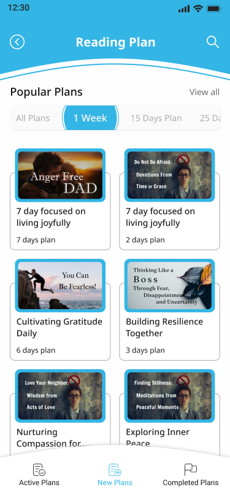
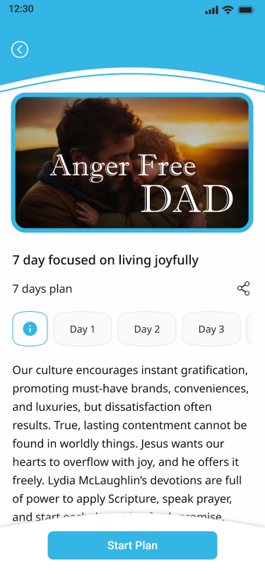
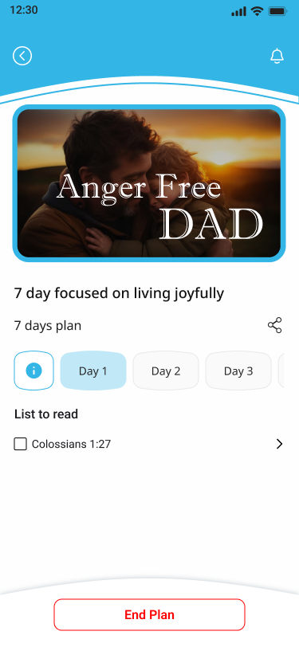
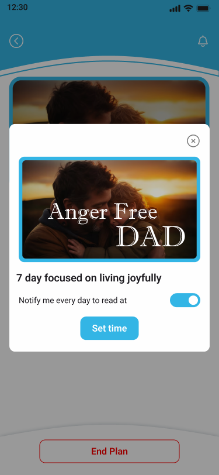
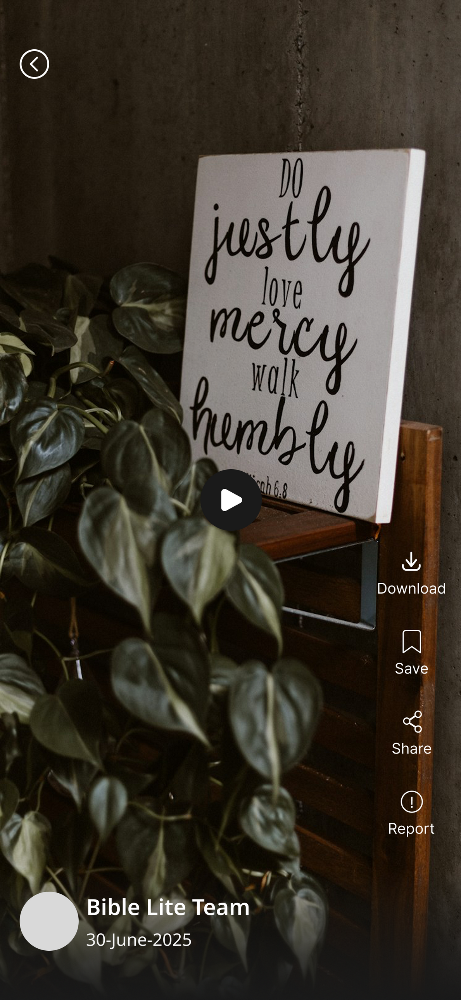

# 📖 Bible App & Bible Lite — Flutter Development Case Study

<p align="center">
  
  
  
  
  
  
</p>

---

## 📌 Project Overview

This case study documents my technical contributions to the development and maintenance of **Bible App** and **Bible Lite** using Flutter and Dart. 

The application suite is designed to nurture daily spiritual reading habits and multimedia engagement through:
- **Curated Bible Reading Plans**: Day-by-day structured plans with progress checklists.
- **Vertical Video Reels (Bible Lite)**: Short-form educational and inspirational video streams with gesture playback controls.
- **Daily Notification Reminders**: Scheduled local alarms to build consistent daily reading habits.
- **Cross-Module Maintenance**: Systematic bug fixing, UI polish, and version release preparation.

---

## 📱 Application Screenshots & Interface Tour

<div align="center">
  <table>
    <tr>
      <td width="20%" align="center">
        
        <br /><b>>Reading Plans Catalog</b>
      </td>
      <td width="20%" align="center">
        
        <br />Plan Detail<b</b>
      </td>
      <td width="20%" align="center">
        
        <br /><b>Daily Scripture Checklis</b>
      </td>
      <td width="20%" align="center">
        
        <br /><b>Notification Scheduler</b>
      </td>
      <td width="20%" align="center">
        
        <br /><b>Vertical Video Reels Playe</b>
      </td>
    </tr>
  </table>
</div>

---

## 👨‍💻 My Role & Key Contributions

**Flutter Developer**

Contributed to core feature engineering, video player architecture, and production update releases across the mobile applications:

### 1. Bible Reading Module & Plans
- Developed the structured reading-plan catalogue organized by thematic topics and durations (30-day, 90-day, annual plans).
- Built interactive day-by-day reading checklists allowing users to check off chapters and track progress visually.
- Contributed to reading module UX improvements, font scaling, and night-mode readability.

### 2. Bible Lite — Vertical Video Reels Module
- Engineered a lightweight, vertically scrolling video reels player for **Bible Lite**.
- Implemented hardware-accelerated playback controls including single-tap play/pause, buffer state spinners, and seamless prefetching.
- Ensured zero audio bleeding when swiping between video cards or navigating away from the screen.

### 3. Scheduled Notifications & Local Reminders
- Implemented local notification scheduling allowing readers to configure personalized daily reminder alarms.
- Handled timezone-aware background notification triggers with deep-linking directly into the active reading plan.

### 4. Multi-Module Maintenance & Release Preparation
- Identified and resolved layout exceptions, state synchronization bugs, and memory leaks across legacy modules.
- Collaborated on regression testing, performance profiling, and production artifact builds for application store releases.

---

## 🛠️ Technical Focus & Architecture

```
┌────────────────────────────────────────────────────────┐
│                   Flutter Presentation                  │
│       (Vertical Reels PageView, Plan Checklists, UI)   │
└───────────────────────────┬────────────────────────────┘
                            │
┌───────────────────────────▼────────────────────────────┐
│                    GetX Controller Layer               │
│     (VideoController, ReadingPlanController, Rx State) │
└─────────────┬───────────────────────────┬──────────────┘
              │                           │
┌─────────────▼──────────────┐ ┌──────────▼──────────────┐
│  Hardware Video Controller │ │  Notification Service   │
│   (Preloading, Volume/Mute,│ │  (Local Daily Triggers, │
│    Aspect-ratio fitting)   │ │   Alarm Permissions)    │
└────────────────────────────┘ └─────────────────────────┘
```

- **Framework**: Flutter & Dart
- **State Management**: GetX (reactive state management & dependency injection)
- **Video Playback**: Hardware-accelerated vertical video controller with memory lifecycle management
- **Local Reminders**: Native background local notifications service
- **Storage**: Caching for plan progress and local checklist states

---

## 💡 Key Learnings & Engineering Outcomes

- **Reels Architecture in Production**: Best practices for instantiating, recycling, and disposing video player controllers during continuous vertical scrolling to prevent memory crashes.
- **Enterprise Codebase Refactoring**: Navigating and improving an existing multi-module Flutter repository while preparing for new production updates.
- **User Engagement Mechanics**: Leveraging lightweight checklists and scheduled notifications to increase user retention and daily active engagement.

---

## 🔒 Project Disclaimer

This repository documents my personal engineering contributions to the project. It does not contain proprietary source code, confidential business data, private API endpoints, or user information.

---

## 👨‍💻 Developer & Contact

**Kabilan R.** — Flutter & Mobile Application Developer  
- **🌐 Portfolio**: [https://kabilan-portfolio-ochre.vercel.app/](https://kabilan-portfolio-ochre.vercel.app/)  
- **🐙 GitHub**: [@Kabilan0624](https://github.com/Kabilan0624)  
- **💼 LinkedIn**: [linkedin.com/in/kabilan-r-91432b268](https://www.linkedin.com/in/kabilan-r-91432b268)  
- **📧 Email**: [kabilanr244@gmail.com](mailto:kabilanr244@gmail.com)
